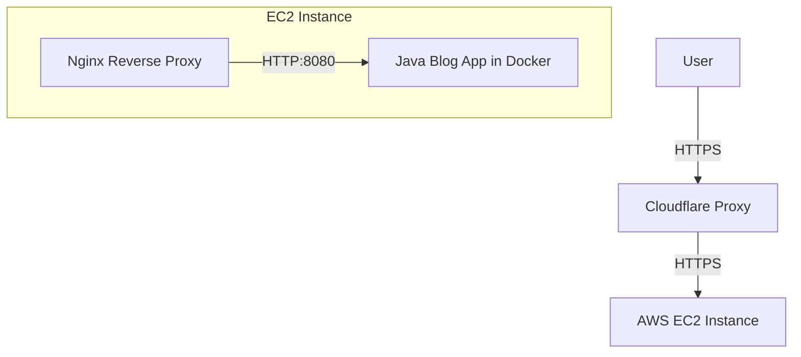

# Automated AWS Infrastructure with GitLab CI/CD

This project demonstrates a professional-grade DevOps workflow for automating the provisioning and configuration of cloud-based infrastructure. It leverages **Terraform** for Infrastructure as Code (IaC), **Ansible** for configuration management, and **GitLab CI/CD** for a fully automated deployment pipeline targeting **AWS**.

## Key Features

- **Self-Hosted GitLab Runner**: The pipeline executes on a private, self-hosted runner (`home-runner`), providing full control over the build environment and security.
- **GitLab-Managed Terraform State**: Utilizes GitLab's built-in Terraform state management, ensuring secure, versioned, and locked state files without requiring external S3/DynamoDB backends.
- **Infrastructure as Code**: Complete automation of AWS resources using Terraform.
- **Automated Configuration**: Post-provisioning setup handled by Ansible roles.

## Architecture Overview

The infrastructure consists of:
- **AWS EC2**: A `t3.small` instance running Ubuntu 22.04 LTS.
- **Cloudflare**: DNS management with a proxied 'A' record for the application.
- **Docker**: Container runtime for hosting the Java application.
- **Nginx**: Reverse proxy with SSL/TLS termination using Cloudflare certificates.



## Project Structure

- [`terraform/`](terraform/): Terraform configuration files for AWS and Cloudflare resources.
- [`ansible/`](ansible/): Ansible playbooks and roles for server configuration.
  - `roles/docker`: Installs and configures Docker.
  - `roles/nginx`: Sets up Nginx as a reverse proxy.
  - `roles/ssl`: Manages SSL certificates.
- [`.gitlab-ci.yml`](.gitlab-ci.yml): GitLab CI/CD pipeline definition.

## CI/CD Pipeline

The pipeline consists of three main stages:

1.  **Plan**: Runs `terraform plan` to preview infrastructure changes.
2.  **Apply**: Runs `terraform apply` to provision resources and exports the server IP.
3.  **Config**: Uses Ansible to configure the provisioned server.

Additionally, the pipeline includes a **manual destroy stage**, allowing the entire infrastructure to be decommissioned in seconds when no longer needed, ensuring cost-efficiency and environment cleanup.

### Required CI/CD Variables

To run the pipeline successfully, the following variables must be defined in GitLab:

| Variable | Description |
|----------|-------------|
| `AWS_ACCESS_KEY_ID` | AWS access key for Terraform. |
| `AWS_SECRET_ACCESS_KEY` | AWS secret key for Terraform. |
| `CLOUDFLARE_API_TOKEN` | API token for Cloudflare DNS management. |
| `SSH_PRIVATE_KEY` | Private key for SSH access to the EC2 instance. |
| `CLOUDFLARE_CERT` | Cloudflare Origin Certificate content. |
| `CLOUDFLARE_KEY` | Cloudflare Origin Private Key content. |

## Getting Started

### Prerequisites
- Terraform 1.7.5+
- Ansible
- AWS and Cloudflare accounts

### Local Deployment
1.  **Initialize Terraform**:
    ```bash
    cd terraform
    terraform init
    ```
2.  **Deploy Infrastructure**:
    ```bash
    terraform apply
    ```
3.  **Configure Server**:
    ```bash
    ansible-playbook -i <server_ip>, ansible/setup.yml
    ```
